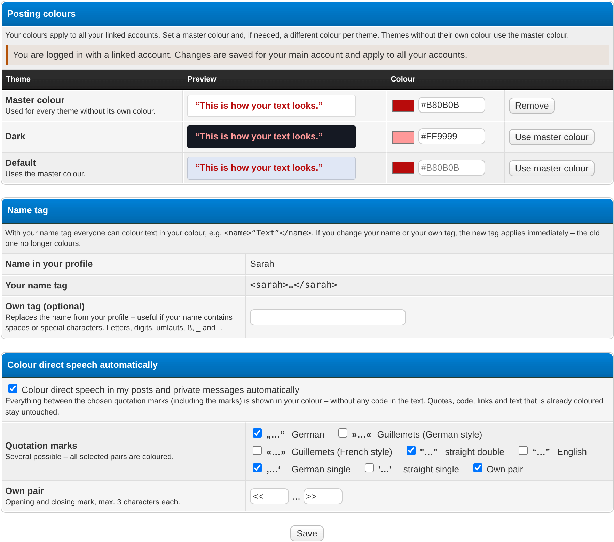
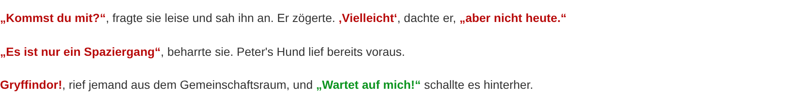
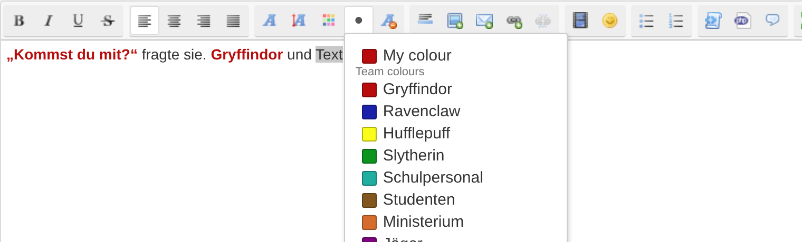
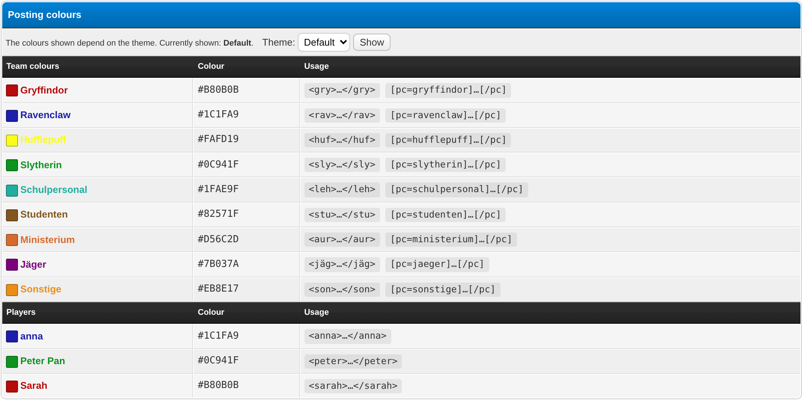
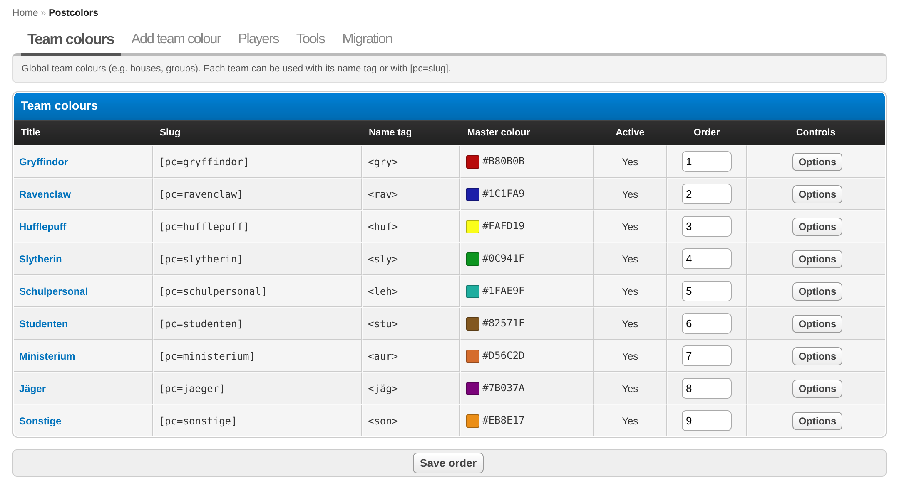
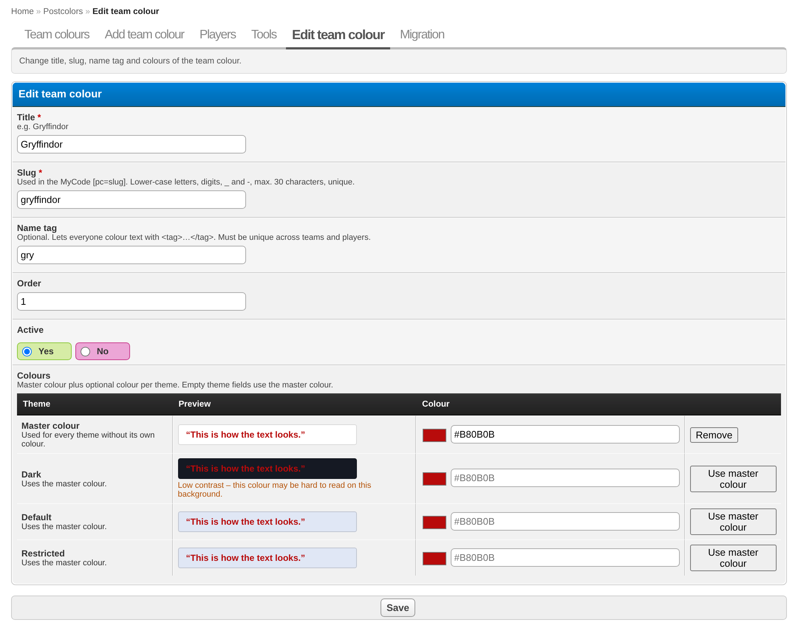

# Postcolors

Posting colours for role-play forums: everyone who plays picks a colour once – optionally a
different one per theme – and it applies to all their linked accounts. Text is coloured with
name tags (`<sarah>…</sarah>`), with the MyCode `[pc]…[/pc]` or automatically for direct
speech. The team manages global team colours (houses, factions, groups) in the Admin CP.

## Requirements
- MyBB 1.8.x
- PHP 7.4 or 8.x
- Optional (recommended): **Enhanced Account Switcher** – colours belong to the main account
  and are shared by all attached accounts. Without it, every account counts as its own player.

## Installation
1. Upload the files to your MyBB root directory (folder structure as in the repository).
2. ACP → Configuration → Plugins → **Postcolors** → Install & Activate.
3. ACP → Configuration → Settings → **Postcolors** → set at least the *player name profile
   field* (ID of the custom profile field that holds the name of the person who plays).

## Upgrade from 1.x
Version 2.0 is a complete rewrite. Your colours are taken over by a migration in the ACP;
posts are **not** changed – `<sarah>…</sarah>` keeps working.

1. **Back up your database.**
2. ACP → Plugins → Postcolors 1.x → **Deactivate – do NOT uninstall** (uninstalling 1.x drops
   the table `colors` with all colours).
3. Upload the new files (this overwrites `inc/plugins/postcolors.php`). Delete the old
   `.tpl` files in `inc/plugins/postcolors/templates/` that do not start with `postcolors_`.
4. ACP → Plugins → **Postcolors 2.0** → Install & Activate. Existing 1.x settings (setting
   group, player name profile field) are taken over.
5. ACP → Configuration → **Postcolors** → **Migration**: start a **dry run**, check the
   report, pick the main account for name conflicts, then **run the migration**.
6. When everything looks fine, delete the 1.x table with the button on the migration tab.

The migration matches each 1.x player name (trimmed, case-insensitive) with the profile field
and assigns the colours to the main account. It can derive a master colour (same colour in all
themes → master colour; otherwise the most frequent colour), skips invalid colours and deleted
themes, removes 1.x templates, template edits and the unused setting, and lists tags that are
used in posts but no longer belong to anyone. It can be run several times without creating
duplicates.

## Usage

### Setting your colour (members)
User CP → **Posting colours** (`usercp.php?action=postcolors`).

- **Master colour** – used for every theme without its own colour.
- **One row per theme** you may use: colour picker plus hex field, live preview on the
  theme background, contrast warning for hard-to-read colours. *Use master colour* clears the
  theme colour.
- **Name tag** – shows your tag. It is the profile field value of your main account
  (case-insensitive). If your name contains spaces or special characters, or the tag is taken,
  choose an **own tag**.
- **Colour direct speech automatically** – tick one or more pairs of quotation marks („…“,
  »…«, «…», "…", “…”, ‚…‘, '…') and/or an own pair. Everything between the marks, including the
  marks, is shown in your colour – without any code in the text. With several pairs, outer
  double quotes are coloured first, so nested quotes („… ‚…‘ …“) are coloured once.

Everything is saved with one button and applies to all your linked accounts at once.

### Colouring text
| Writing | Result |
|---|---|
| `<sarah>“Hello”</sarah>` | Sarah's colour – usable by everyone, e.g. for another character's speech |
| `<gry>…</gry>` | team colour with the name tag *gry* |
| `[pc]…[/pc]` | colour of the person who wrote the post |
| `[pc=gryffindor]…[/pc]` | team colour by slug |
| `“…”` (with automatic colouring switched on) | your colour, automatically |

Name tags work everywhere posts or private messages are shown – also in forums without HTML,
previews, signatures, the portal, search, print view and archive. Unknown tags are left alone.
Inside `[code]`/`[php]` tags stay text. Quotes keep the colour of the person who wrote the
quoted post.

### Editor button
The editor gets a **posting colour** button. Select text, click the button and choose *My
colour* or a team colour. Depending on the setting it inserts the name tag or `[pc]`. In the
WYSIWYG editor coloured passages are shown in colour.

### Overview
`postcolors.php` lists all team colours and every player with their colour in the current theme
(another allowed theme can be chosen), plus the tag to copy. The old address
`misc.php?action=postcolors` redirects there. To show the overview inside the frame of your other
lists, enter the frame template (e.g. `listen`) and the navigation template (e.g. `listen_nav`) in
the settings; the frame receives `{$listen_content}`, `{$listen_nav}` and `{$headline}`.

### Team colours (admins)
ACP → Configuration → **Postcolors** → *Add team colour*: title, slug (for `[pc=slug]`),
optional name tag, order, active, master colour and optional colour per theme. The list can be
sorted; teams can be edited or deleted.

### Tools (admins)
*Players* lists everyone with colours, their tag, conflicts and lets you delete their data.
*Tools* shows the status (Account Switcher, profile field, tags, conflicts) and rebuilds the
cache.

## Configuration
- **Enable Postcolors** – colour output, name tags, `[pc]`, User CP page and overview.
- **Who may set colours** – user groups that may use the User CP page (saved colours are
  always shown).
- **Player name profile field** – ID of the profile field with the player name.
- **Background CSS variable** / **Fallback background colour** – background for the preview,
  read from the theme stylesheets (including parent themes).
- **Bold coloured text**
- **Element selectors** – also output `sarah{…}` so raw HTML outside the parser is coloured.
- **Editor button inserts** – name tag or `[pc]`.
- **Overview: frame template** / **navigation template** – optional, embed `postcolors.php` into
  the frame of your other lists.
- **Allow automatic colouring of direct speech**, **Forums with automatic colouring**,
  **Automatic colouring in private messages**.

## Uninstallation
ACP → Configuration → Plugins → **Postcolors** → Deactivate, then Uninstall. This removes all
tables, settings, templates, the template group, the stylesheet and the cache.

## Changelog
See [CHANGELOG.md](CHANGELOG.md).
